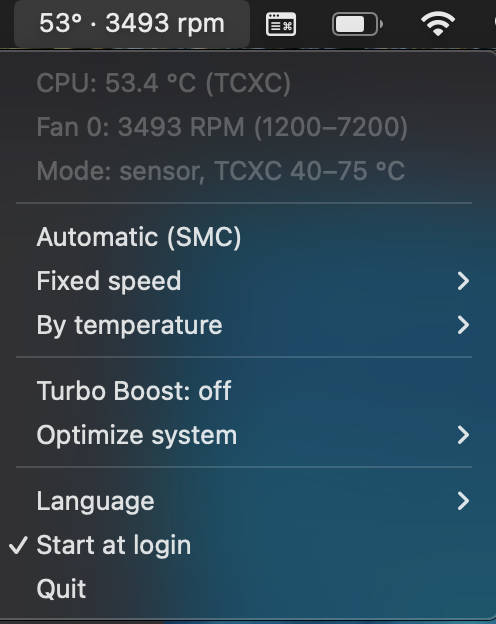

<p align="center">
  
</p>

<h1 align="center">Intel Mac Tuner</h1>

<p align="center">
  Fan control, Turbo Boost switch and safe system optimization for Intel Macs — a free, open-source menu bar app written in Rust.
</p>

<p align="center">
  <a href="https://github.com/Conehard/intel-mac-tuner/actions/workflows/ci.yml"></a>
  <a href="https://github.com/Conehard/intel-mac-tuner/releases/latest"></a>
  <a href="LICENSE"></a>
  
  
</p>

<p align="center">
  <a href="https://github.com/Conehard/intel-mac-tuner/releases/latest"><b>⬇ Download the latest release</b></a>
</p>

<p align="center">
  
</p>

<p align="center"><sub>Temperature and fan speed in the menu bar. Everything else is one click away.</sub></p>

Older Intel Macs (MacBook Pro, MacBook Air, iMac, Mac mini) run hot, spin their fans loud
and stutter under load. Intel Mac Tuner brings together, in a single tool, what helps
those machines stay productive:

- **Fan control**: fixed speed, or a temperature curve, with safety limits.
- **Turbo Boost on/off**: less heat and noise when you don't need peak speed.
- **System optimization**: lighter visual effects, no background updaters, Spotlight
  pause, memory purge, optional Apple services off — all reversible.

It works on any Mac with an Intel processor, including 8 GB models and Macs running a
macOS version newer than the one officially supported (for example with OpenCore Legacy
Patcher). There is a CLI (`tunerctl`), a daemon that starts at boot, and a menu bar
app, all in pure Rust, with no Swift and no Xcode.

## Download (no build needed)

If you just want to use it, grab the latest build from the
[**Releases**](https://github.com/Conehard/intel-mac-tuner/releases) page. Each release
ships a `.zip` with the `Intel Mac Tuner.app`, the `tunerctl` and `intelmactunerd`
binaries, the Turbo Boost kext and an `install.sh`:

```sh
unzip intel-mac-tuner-macos-x86_64.zip
cd intel-mac-tuner
./install.sh
```

The app is not signed by an Apple Developer account, so the first time you open it macOS
may warn you. Right-click the app and choose **Open**, or allow it in
**System Settings › Privacy & Security**. The optimization features that need root go
through the daemon, which `install.sh` sets up.

Prefer to build it yourself? Read on.

## Requirements (building from source)

- A Mac with an Intel processor, macOS 10.13 or newer
- Rust 1.77 or newer (`~/.cargo/bin` on your PATH)

The project has no external dependencies; the build downloads no crates.

## Install the daemon

```sh
cargo build --release
sudo ./target/release/tunerctl install
tunerctl status
```

`install`:

- copies `intelmactunerd` and `tunerctl` to `/usr/local/bin`;
- creates `/Library/Application Support/IntelMacTuner/config.toml` in **auto** mode, if it doesn't exist yet;
- creates and loads `/Library/LaunchDaemons/dev.intelmactuner.daemon.plist`, which starts at boot and restarts if it crashes.

## Menu bar app

```sh
scripts/make-app.sh
open ~/Applications/Intel\ Mac\ Tuner.app
```

It shows `62° · 2410 rpm` in the menu bar. The menu has the temperature, the RPM, the
fan mode (Automatic, Fixed speed, By temperature), Turbo Boost, the "Optimize system"
submenu, the language (English/Portuguese) and "Start at login". It talks to the daemon
over the socket; this is where you operate everything without the terminal.

## Fan mode

From the menu bar, or from the terminal (no sudo, for administrator users):

```sh
tunerctl mode
tunerctl mode fixed 3000
tunerctl mode sensor 50 85
tunerctl mode auto
```

The change is saved in `config.toml` and persists after a reboot. For fine-tuning
(sensor, hysteresis, speed range), edit the file and reload:

```sh
sudo nano "/Library/Application Support/IntelMacTuner/config.toml"
tunerctl config check
sudo tunerctl reload
tail -f /var/log/intelmactunerd.log
```

| `mode` | What it does |
| --- | --- |
| `auto` | the SMC controls (factory default) |
| `fixed` | fixed speed at `fixed_rpm`, clamped to the fan's range |
| `sensor` | linear curve: `temp_min_c` → min speed, `temp_max_c` → max speed; rises immediately, falls at most 300 RPM per second and only when the temperature drops by `hysteresis_c` |

## Turbo Boost (optional)

Turning Turbo Boost off reduces heat and noise on machines that run hot. It uses a kext
(kernel extension) that writes to the CPU's MSR `0x1A0`. macOS must allow third-party
kexts (with the OpenCore Legacy Patcher this is usually already enabled; otherwise run
`csrutil enable --without kext` once in Recovery).

```sh
sh kext/build-kext.sh
sudo tunerctl install-turbo
tunerctl turbo off
tunerctl turbo on
tunerctl turbo
```

On the first load, macOS may ask you to approve the extension in
System Settings › Privacy & Security, and reboot. The chosen state is saved in
`config.toml` (`[turbo] manage`, `enabled_on_boot`) and is reapplied at boot and after
waking from sleep. The menu bar has a "Turbo Boost" item.

Convention: kext LOADED = Turbo OFF (loading it sets bit 38 of the MSR).

## System optimization

Everything here is **reversible** and recorded in a journal, so it can be undone. The
report is read-only; the actions have an "undo". The tool never touches Apple system
daemons or the OpenCore Legacy Patcher agents.

```sh
tunerctl system report
tunerctl system trim visual
tunerctl system trim updaters
tunerctl system trim apple
tunerctl system spotlight off
tunerctl system spotlight on
tunerctl system purge
tunerctl system restore
```

| Action | What it does | Level |
| --- | --- | --- |
| `report` | read-only report: what is weighing on things (CPU, GPU, disk, memory) | user |
| `trim visual` | reduces transparency and animations (eases the GPU) | user |
| `trim updaters` | disables third-party updaters at startup (yours and the system's stay) | user |
| `trim apple` | disables optional Apple services (photo/media analysis, Siri) | daemon |
| `spotlight off` / `on` | pauses/resumes Spotlight indexing | daemon |
| `purge` | frees inactive memory right away | daemon |
| `restore` | undoes everything that was applied | both |

The actions marked **daemon** need the daemon installed and running
(`sudo tunerctl install`). The **user** ones work on their own. Everything is also in the
"Optimize system" submenu of the menu bar, with on/off checkmarks and "Undo optimizations".

Disabled visual effects and services only fully change after you log out and back in
(or reboot).

## FAQ

**Is this an alternative to Macs Fan Control and Turbo Boost Switcher?**
It covers the same ground — fan speed control and a Turbo Boost switch — in one open-source
tool, plus reversible system optimizations for slow Macs.

**How do I make my old MacBook Pro run cooler and quieter?**
Turn Turbo Boost off and use the "By temperature" fan mode from the menu bar. Turbo Boost
is what pushes the CPU to its hottest, and the curve keeps the fans from jumping around.

**My Mac stutters on a recent macOS (unsupported Mac / OpenCore Legacy Patcher). What helps?**
Use *Optimize system* in the menu: lighter visual effects, no third-party updaters at
startup, Spotlight paused while you work, and a memory purge when memory is tight. Every
step has an undo.

**Is it safe?**
Yes. Fans always return to the SMC's automatic control when the daemon stops or sleeps, a
thermal panic forces maximum fan speed at 95 °C, and the optimizer never touches Apple
system daemons or OpenCore Legacy Patcher agents. See [Daemon safety rules](#daemon-safety-rules).

**Does it work on Apple Silicon (M1/M2/M3)?**
No. It is built for Intel Macs only.

## Daemon safety rules

1. Temperature ≥ `panic_temp_c` (default 95 °C): fans at maximum until it drops 5 °C, in any mode.
2. No temperature reading: control returns to the SMC.
3. Speed always within `F{n}Mn..=F{n}Mx`; only writes `FS! `/`F{n}Md` and `F{n}Tg`.
4. On stop (SIGTERM, `uninstall`, persistent error or process panic): fans back to the SMC.
5. Before sleep: fans back to the SMC. On wake: the mode is reapplied.
6. If another program changes the fan, the daemon reapplies on the next tick. Don't run another fan controller at the same time.

## Other commands

```sh
tunerctl fans | temps | report | smc list | smc read TC0P
sudo tunerctl fan test 0 --rpm 3000 --seconds 15
sudo tunerctl uninstall [--purge]
```

To remove the menu bar app, quit it and delete `/Applications/Intel Mac Tuner.app`
(or `~/Applications`). `tunerctl uninstall` removes the daemon.

## Layout

| Path | Contents |
| --- | --- |
| `crates/smc` | AppleSMC protocol (IOKit), `fpe2`/`flt `/`sp78` types, fans and sensors, fake SMC for tests |
| `crates/tuner` | `config.toml`, controller, control socket, sleep/wake, system optimization; the `intelmactunerd` binary |
| `crates/tunerctl` | CLI: fans, `mode`, `system`, Turbo, install/uninstall/reload/status |
| `crates/menubar` | menu bar app (testable `model.rs` + `objc.rs`/`app.rs` with AppKit) |
| `kext/` | DisableTurbo kext (C) + `build-kext.sh` (builds without Xcode) |
| `scripts/make-app.sh` | builds the `.app` with Info.plist, icon and an ad-hoc signature |
| `scripts/install.sh` | one-step installer shipped inside each release zip |
| `.github/workflows` | CI (format, lint, tests) and the Release build |
| `assets/` | app icon (`icon.png`, `AppIcon.iconset`), its generator and the README screenshot |

## Tests

```sh
cargo test
cargo clippy --workspace --all-targets -- -D warnings
```

Outside macOS, `cargo check --workspace --features smc/check-ffi,tuner/check-ffi,menubar/check-ffi`
type-checks the IOKit/CoreFoundation/AppKit code without linking.

## Disclaimer

This software changes fan speeds, CPU Turbo Boost and system settings. It is provided
"as is", without warranty of any kind, and you use it at your own risk. It has been
tested on a limited set of Macs, so start with the default settings and watch your
temperatures. See [LICENSE](LICENSE) for the full terms.

## Support the project

Intel Mac Tuner is free and open source. If it kept an old Mac useful for you and you want
to support its development, donations are welcome — never required.

| Network | Address |
| --- | --- |
| Bitcoin (native SegWit) | `bc1q9sv0xgp9sqgsxpvuytny69jg2az3cj63xhlsqf` |
| Solana | `HZMm9eAwJUdVtrPqGaREjNZd1wBiKToNVXCbGk949JFe` |
| USDT (Tron / TRC-20) | `TGTJrkySXVrSaf3wHeWnTPCt7GJM3d6Rwy` |

Please double-check the network before sending: funds sent on the wrong network can't be
recovered. Starring the repository and sharing it also helps a lot.

## License

GPL-3.0. See [LICENSE](LICENSE). Modified versions that you distribute must stay open under the same license.
